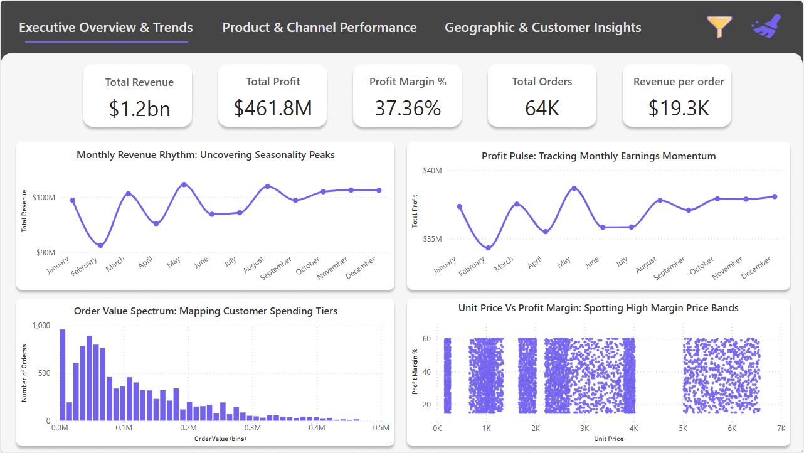
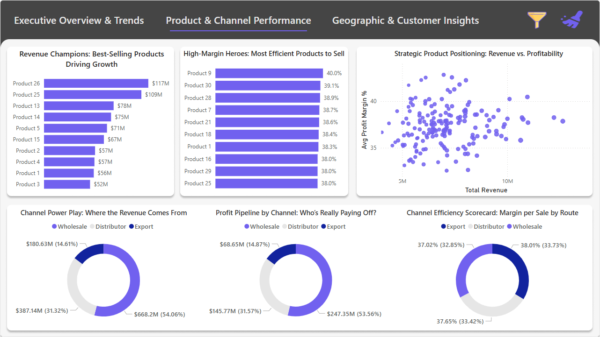
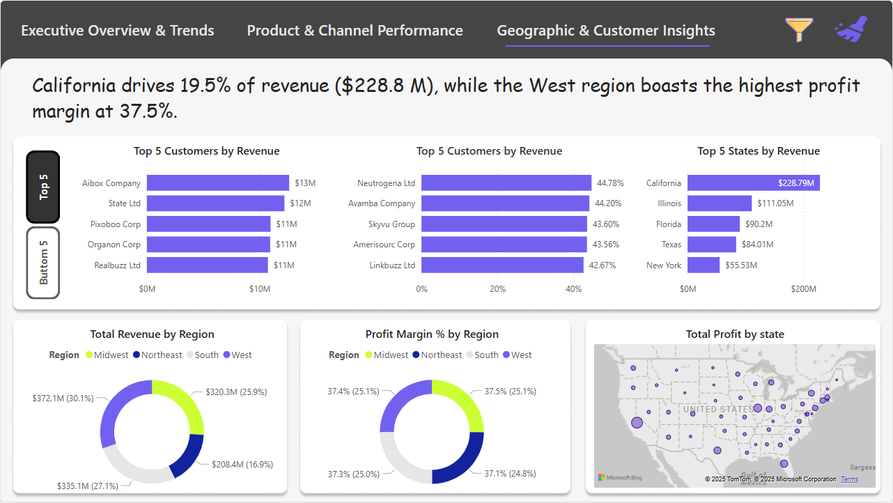

# USA Regional Sales Analysis: Python EDA + Power BI Dashboard

Analysis of **64,104 sales transactions (2014 – Feb 2018, $1.24B revenue)** for a US company selling 30 products to 175 customers through Wholesale, Distributor and Export channels. A Python EDA cleans and joins six tables and finds the revenue and profit drivers; a three-page Power BI dashboard presents them.

**Author:** Mayuresh Nagwekar ([GitHub](https://github.com/mayureshnagwekar8-sudo) · [LinkedIn](https://www.linkedin.com/in/mayuresh-n-029610216))

## Dashboard



| Product & Channel Performance | Geographic & Customer Insights |
| --- | --- |
|  |  |

- **Executive Overview & Trends:** revenue, profit, margin, transactions and revenue per transaction; monthly revenue and profit; transaction value distribution; unit price vs margin.
- **Product & Channel Performance:** top products by revenue and by margin, customer revenue vs margin, channel split of revenue, profit and margin.
- **Geographic & Customer Insights:** top and bottom customers, top states, revenue and margin by region, profit map.

All pages filter by channel, region, month and year.

## Key Findings

| | |
| --- | --- |
| Total revenue / profit | **$1.24B / $461.8M**, 37.4% margin |
| Annual revenue | Flat at $294–298M per year (2014–2017) |
| Channels | Wholesale 54%, Distributor 31%, Export 15%; margins within 1 point (37.1–37.9%) |
| Regions | West 30.1%, South 27.1%, Midwest 25.9%, Northeast 16.9%; margins all 37.1–37.5% |
| Top state | California, $228.8M (18.5% of revenue) |
| Top products | Product 26 ($117M) and Product 25 ($110M) |
| Highest margin | Product 9, 40.0%, but only about $15M revenue |
| Customer concentration | Low: top 10 of 175 customers = 8.8% of revenue |

1. **Seasonality is mild.** May and August are the strongest months, and February is the weakest, mostly because it's shorter. February 2017 ($21.2M) is the lowest month, about 8% below other Februaries.
2. **Growth is a volume question, not a pricing one.** Margins barely differ by channel, region or customer size, so regional and channel gaps come from sales volume.
3. **The Northeast is the clearest expansion target:** the smallest region with the same margins as the rest.
4. **Product 9 is a growth candidate:** the best margin of all 30 products but one of the lowest revenues.

## Data

Source workbook `data/Regional Sales Dataset.xlsx`:

| Sheet | Rows | Contents |
| --- | --- | --- |
| Sales Orders | 64,104 | Date, customer, channel, product, region, quantity, unit price, line total, unit cost |
| Customers | 175 | Customer names |
| Products | 30 | Product names |
| Regions | 994 | US cities with state, coordinates, population |
| State Regions | 48 | State → US region (header row stored as data; fixed in the EDA) |
| 2017 Budgets | 30 | Annual budget per product |

The EDA joins these into one table, adds `total_cost`, `profit` and `profit_margin_pct`, and exports `data/Sales_data(EDA Exported).csv`, which the Power BI report reads.

### Data quality notes

- **Order numbers are not unique.** Each of the 10,684 order numbers appears exactly 6 times, on different dates and in different regions. Each row is treated as one transaction.
- **Don't sum the `budget` column.** The annual product budget is repeated on every 2017 transaction, so summing it gives $45.6B instead of the real $62.7M. The EDA compares budget vs actual per product instead.
- **Budget scale needs confirming.** Every product's 2017 revenue is 3.4–6.3× its budget, which suggests the two tables are on different scales.

## Corrections Made in This Version

The original EDA had some charts and insights that didn't match the data. All insights have been re-checked against the notebook's output.

- **Order value was inflated 6×.** The order-value histogram grouped by order number, which adds up 6 unrelated transactions. It now uses one transaction per row.
- **Mislabelled margin chart.** "Top 10 Products by Avg Profit Margin" plotted average profit in dollars. It now shows profit margin %, matching the dashboard.
- **Insights fixed:** region shares added up to 119% (now 30.1/27.1/25.9/16.9%); January was called both the trough and the peak (February is the weakest month); "top customers create concentration risk" (the top 10 are only 8.8%); "near-$0 promotional prices" (the minimum price is $168); and the channel margin spread was understated as under 0.2 points (it's 0.84).
- Two section headers were swapped (states vs customers), and the Colab Drive path was replaced with a relative path.

### Dashboard fixes to make next

- The Geographic page headline says California drives **19.5%** of revenue and **West** has the highest margin. The actual figures are **18.5%**, and **Midwest** is highest (37.5% vs West 37.4%).
- **"Total Orders: 64K"** counts transactions. Rename it "Total Transactions", since there are only 10,684 distinct order numbers.
- The middle chart on the Geographic page is titled "Top 5 Customers by Revenue" but shows profit margin %.
- **Profit margin donuts** (by channel and region) show margins as shares of a whole, which isn't meaningful. Use a bar chart instead.

## Project Structure

```
├── EDA_Regional_Sales_Analysis.ipynb   # cleaning, feature engineering, 15 charts, insights
├── data/
│   ├── Regional Sales Dataset.xlsx     # raw workbook (6 sheets)
│   └── Sales_data(EDA Exported).csv    # cleaned table used by Power BI
├── dashboard/Regional_Sales_Report.pbix
├── docs/Regional_Sales_Analysis.pptx   # presentation of approach, EDA and dashboard
└── images/                             # dashboard screenshots
```

## How to Run

```bash
pip install -r requirements.txt
jupyter notebook EDA_Regional_Sales_Analysis.ipynb
```

The state choropleth uses Plotly, which GitHub doesn't render. Run the notebook to see it.

Open `dashboard/Regional_Sales_Report.pbix` in Power BI Desktop. If prompted, point the data source to `data/Sales_data(EDA Exported).csv`.

## Tech Stack

Python, pandas, NumPy, matplotlib, seaborn, Plotly, Power BI (DAX, custom visuals)
